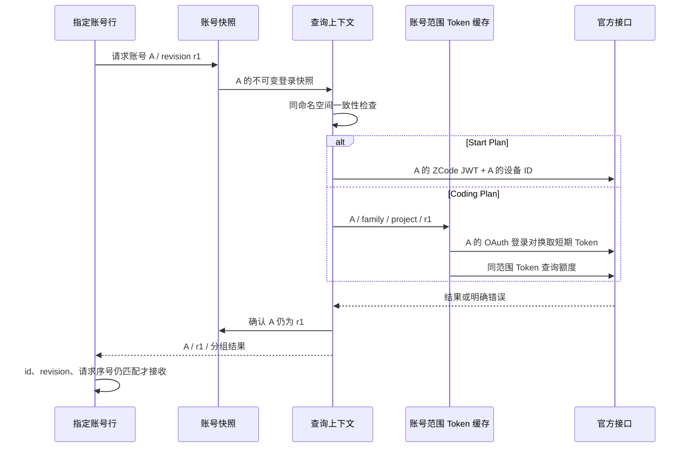

# Quota Account Isolation Implementation Plan

> **For Claude:** REQUIRED SUB-SKILL: Use superpowers:executing-plans to implement this plan task-by-task.

**Goal:** 修复账号额度串用和同套餐重复展示，优先支持 ZCode 3.16.x，兼容已有账号快照。

**Architecture:** 从指定账号快照建立不可变查询上下文，将账号身份、登录代次、平台、套餐及项目范围贯穿凭证解析、网络请求、缓存、结果合并与界面回填。Start Plan 使用该账号自己的 ZCode JWT；Coding Plan 按 3.16.x 的流程取得项目短期 Token。历史凭证保留在磁盘，但不再作为无范围的查询候选集合。

**Tech Stack:** Rust / Tauri 2 / serde_json / ureq；前端原生 JavaScript / Vite；Rust 单元测试与 Node 内置测试运行器。

---

## 1. 状态、范围与依据

- 状态（2026-10-26）：阶段 A/B 已实施，本地回归与 11 份副本的实际 CLI 查询已执行；官方界面数值对照、原生 UI 实际账号验收和跨平台 CI 待完成。详见[验收记录](../testing/quota-account-isolation.md)，不代表全部验收通过。
- 用户确认：优先 ZCode 3.16.x，兼容已有快照；不承诺完整兼容 3.11–3.14 的历史协议。
- 工作基线：本仓库 `f34225686dfef05d84c256a56f868719248f15ff`，版本标记 `1.7.0-beta.1`。
- 实际安装：zcode-switch 1.6.0；ZCode 3.16.3.8992。
- 对照源码：相邻 `zcode-src` 仓库 `aac4755`，版本 3.15.1；相关身份、项目 Token 和设备 ID 逻辑已与安装包 `app.asar` 静态交叉检查。
- PR 参考：[pjpv/zcode-switch#35](https://github.com/pjpv/zcode-switch/pull/35)，检查时 head 为 `2acbdad3cfb62cae877543e6d3467ec54bbb3a82`，未合并。
- 已有 11 份快照；4 份混有历史账号的 Coding Plan 凭证。下面的测试全部使用人工构造账号 A/B/C，不复制真实快照、令牌、账号 ID 或设备 ID。
- 计划编写阶段只写计划；实施不得把修改开源 ZCode、安装包、真实账号文件作为修复前提。

### 方案选择

| 方案 | 收益 | 局限 | 决策 |
| --- | --- | --- | --- |
| 分两阶段完成账号隔离与 3.16.x 协议适配 | 同时解决串号和旧凭证失效；可分别验证 | 需要增加少量后端模块和回归测试 | 采用；两个阶段均完成后才称为完整修复 |
| 直接合并 PR #35 | 旧 config 中停用渠道减少；部分重复项消失 | credentials、失败回退及账单凭证路径仍可串号 | 不作为完整修复 |
| 清理历史账号文件 | 短期减少混杂数据 | 无法阻止再次产生；可能删除客户端仍保留的数据 | 不作为默认方案 |

阶段 A 完成身份边界、禁用无归属回退和请求设备上下文；阶段 B 完成项目 Token、套餐合并、UI 失效处理与端到端验收。阶段 A 中暂不可查询的 Coding Plan 必须显示明确状态，不能继续调用旧候选扫描器。

## 2. 已确认的故障路径

1. `quota.rs::coding_plan_api_keys` 只将 enabled provider 排在前面，仍读取停用 provider。
2. `quota.rs::coding_plan_keys_from_creds` 扫描所有 `account-provider:*coding-plan*:api-key`，不校验所属账号、平台和项目。
3. `quota.rs::zai_billing_token` 在 BigModel 场景回退读取 config 内 Start Plan key；本机存在该 key 属于另一 Z.ai 账号的实例。
4. `quota_for_live` 在渠道失败后调用无范围的 `candidate_tokens / query_quota`，前置过滤不能约束这条回退路径。
5. `merge_parts` 没有账号和项目范围；PR 的相同 pid 保留第一条可能使错误账号的数据成为唯一剩余结果。
6. `quota.rs::device_mid` 通过进程级 `OnceLock` 缓存 live 设备 ID；普通额度查询没有显式使用目标账号的 `virtual_device_mid`。
7. 新版客户端的 `provider_config.json` 与旧 `config.json` 并存；旧配置仍被 switch 快照保存并查询。
8. 快照内 ZCode 用户 ID 与 OAuth 业务 Token 的 user_id 不同：本机 11/11 份均如此。不能把这两种命名空间强行判等。

补充：前端按账号 id 保存额度，没有发现一个明确的全局额度变量覆盖所有行的证据；但账号凭证更新时仍需防止旧请求回填。

## 3. 必须满足的产品规则

1. 查询 A 的过程中，只能使用 A 当前登录对及由其签发的项目 Token。失败不能改查 B 或另一平台。
2. `enabled: false` 的历史 provider、无法归属的 config key、历史账号 provider key 均不能成为查询候选。
3. 3.16.x 的查询不依赖旧 config 的 enabled 状态推断权益；权益来自当前账号的官方接口。用户停用某个模型 provider 不等于退订套餐。
4. 单纯查询额度不修改账号快照、live credentials、provider 配置、设备状态或设置；不自动创建组织、项目、长期 API Key，不领取套餐。
5. 允许在正常鉴权流程中，为已存在的 API Key ID 签发短期项目 Token。该操作为 POST，不能在文档中误称整个查询链路只有 GET。
6. 身份不完整、鉴权失败、接口格式未知、网络失败与“已确认无套餐”分开处理。
7. 查询一个账号失败不抹掉其他账号的有效结果；部分渠道成功时可以展示已确认部分，同时提示未完成部分。
8. 同一账号不同团队项目的额度分别保留；不得跨账号、平台、项目或有效期粗暴去重。
9. 登录材料变化、删除账号或请求过期后，旧响应不能写回当前 UI，也不能更新新登录代次的缓存。
10. 用户已有设备 ID 保持稳定；普通刷新不生成或轮换设备 ID。

## 4. 身份、凭证与状态所有者

新增 `src-tauri/src/quota_auth.rs`，集中实现以下契约；以下类型是目标设计，不是已经存在的 API。

```rust
pub(crate) struct AccountScope {
    pub snapshot_id: String,
    pub family: ProviderFamily,
    pub zcode_subject: String,
    pub revision: String,
}

pub(crate) struct AccountQueryContext {
    pub scope: AccountScope,
    pub auth: AccountAuth,             // 不实现 Serialize；Debug 必须脱敏或不实现
    pub device_mid: Option<String>,
    pub app_version: String,
}

pub(crate) enum PlanScope {
    Start,
    Personal { organization_id: String, project_id: String },
    Team { organization_id: String, project_id: String, product_id: String },
}

pub(crate) fn resolve_account_context(
    snapshot: &Account,
    secret: &str,
    app_version: &str,
) -> Result<AccountQueryContext, QuotaError>;
```

具体规则：

- `snapshot_id` 是 switch 的账号记录 ID；不是远端 user_id。
- `family` 优先来自该快照的 `oauth:active_provider`。字段缺失时，仅允许唯一、无歧义的当前登录信息推导；禁止默认猜 zai 或从历史 provider key 推导。
- ZCode 身份支持 `user_info.id`、旧 Z.ai profile 的 `user_info.user_id`、该快照 ZCode JWT 的已知身份字段；数值和字符串 ID 按已确认格式规范化。缺失不等于冲突。
- ZCode JWT 与 profile 的同命名空间字段相互矛盾时，在发请求前失败；不按邮箱、显示名匹配。
- OAuth 业务 Token 只读取 `oauth:{family}:access_token`，不遍历另一 family；其 business subject 单独保存，不与 ZCode subject 比较。关联依据是同一快照当前登录对及登录代次。
- JWT 本地解码仅用于一致性和过期检查，不等同于签名验证；有效性仍以服务器鉴权为准。没有 exp 不能直接判过期。
- 若将来需要修复“当前登录对自身互相错配”，必须用官方账户接口建立身份映射，不可发明跨命名空间的字符串转换。
- `revision` 对影响本次查询的登录对、身份、设备 ID 和明确套餐范围生成稳定摘要；历史无关 provider key 不决定归属。摘要用于内部比较，不记录原始凭据。
- 账号文件由 store 层持有；解密与 scope 构建是纯函数；项目 Token 与进行中的请求由账号范围的进程内服务持有；UI 只持有结果和 revision。
- 非活动账号查询不读取 live credentials、live provider 选择或 live deviceMid 作为自身凭证来源。
- `live_quota` 是独立入口：显式读取同一 live 状态的凭证和设备 ID，完成后检查登录代次；不能用于其他快照的兜底。



## 5. 3.16.x 查询协议

### 5.1 Start Plan

- 使用目标快照自己的 `zcodejwttoken`，经上下文一致性检查后请求现有 billing/balance。
- BigModel 与 Z.ai 均不从旧 config 任取 `start-plan` key。
- 缺少或冲突时返回“登录信息需要更新”；缺少账号设备 ID 返回明确状态，在显式新增、导入、更新或切换的生命周期补齐，额度查询本身不写盘。
- 将 `device_mid`、版本及必要头参数显式传入 HTTP adapter；已有非账号用途的版本缓存可以保留。

### 5.2 Coding Plan：定位项目并签发 Token

新增 `src-tauri/src/project_token.rs`。参考文件：

- `../zcode-src/packages/shared/src/project-access-token-client.ts`
- `../zcode-src/packages/shared/src/project-access-token.ts`
- `../zcode-src/packages/shared/src/project-access-token-response.ts`
- `../zcode-src/packages/services/src/model-provider/accountProviderRequestAuthService.ts`
- `../zcode-src/packages/services/src/bigmodel/codingPlanEntitlement.ts`

协议表按上述源码和已安装 bundle 核对；实现时用人工 fixture 固定每一步的请求方法、鉴权格式和响应字段。

| 用途 | 平台/地址 | 规则 |
| --- | --- | --- |
| Z.ai 业务接口 | `https://api.z.ai` | 按该接口的 Z.ai 鉴权契约 |
| BigModel 业务接口 | `https://bigmodel.cn` | 按该接口的 BigModel 鉴权契约；不沿用旧固定 open.bigmodel.cn |
| 客户/组织/项目 | `GET /api/biz/customer/getCustomerInfo` | 只使用当前快照的 OAuth 登录凭证 |
| 已有 Key ID | `GET /api/biz/v1/organization/{org}/projects/{project}/api_keys` | 个人/团队各自选择；禁止混用项目 |
| 短期 Token | `POST .../api_keys/{keyId}/access_tokens` | Bearer 登录凭证；body 含 clientType=zcode 和探测出的 clientVersion |
| 个人订阅 | `GET /api/biz/subscription/list` | 按对应平台和契约使用本范围 Token |
| 团队订阅 | `GET /api/biz/team/subscribe/product/querySubscribeDetail` | 使用本账号业务凭证及明确组织/项目 headers |
| 额度 | `GET /api/monitor/usage/quota/limit` | 对应平台、项目短期 Token；团队范围按客户端契约携带 |

- BigModel 管理接口可能使用裸登录 Token，Z.ai 对应接口可能使用 Bearer；签发接口另有 Bearer 规则。不可通过一个通用 `Bearer` 拼接器覆盖全部接口。
- 个人项目排除 `projectType == 2`，优先默认机构/项目，遵守官方选择规则。
- 团队范围必须从本账号可访问组织/项目与团队订阅接口确认。多个有效团队项目分别展示；不能把第一个项目当成所有团队的额度。
- 旧快照的 `project-key-location:v1:*` 只作为定位提示：必须匹配 origin、family、账号、usageScene 与项目选择，并通过官方响应验证权限。首版不写回该缓存到账号文件。
- 历史 `account-provider:*:api-key` 可用于脱敏诊断“存在历史键”，不作为 3.16.x 的额度请求凭据。
- 只复用已存在且符合个人/团队契约的 Key ID。缺失时提示先在 ZCode 中完成该套餐初始化；查询轮询不执行官方客户端可能采用的“创建长期 Key”分支。
- 团队身份不明确、订阅未知或项目不可访问时，显示这一范围无法确认；不能当作无套餐，也不能借用 live 全局团队选择。
- `enable:false`、无效 Token 响应、权限拒绝时停止本范围；不得回退长期 key、另一个账号或另一平台。

### 5.3 缓存、并发与刷新

- 缓存键至少包含 `(snapshot_id, revision, origin, family, zcode_subject, org, project, api_key_id, usage_scene)`。
- 不直接照搬客户端仅按 `(origin, family)` 管理单一活动登录的 session map；switch 同时查询多个同平台账号，必须独立保存。
- Token 仅驻留内存；缓存只合并同范围的进行中请求。网络调用期间不得持有全局账号存储锁。
- 有效期取 `min(expiresAt * 1000, request_started_at + expiresIn * 1000)`；按客户端规则提前刷新并抖动，时钟可注入测试。
- 401 只清理该 Token 所属范围，最多重新签发并重试一次；不影响其他账号。
- 网络/429 临时失败仅允许继续使用同范围、尚未过期且未被拒绝的 Token；不能延长原有效期。Retry-After 和重试次数有上限。
- 账号凭证 revision 变化或删除时使对应缓存与进行中结果失效。人工刷新和自动轮询共用这套服务，保持现有轮询节奏，避免为每张卡片重复签发。

## 6. 合并、错误与界面回填

- 保留现有 `QuotaOverview` 常用显示字段；增加账号 revision、完成状态与分范围错误，不向前端传凭证、原始业务响应或真实设备 ID。
- 内部结果先携带 AccountScope 和 PlanScope，进入合并前验证都属于本次查询上下文。
- 优先按真正的订阅/权益实例 ID 去重，并包含账号、family、项目范围与计量窗口。`plan_id` 可能只是产品类型，不能单独作为全局唯一 ID。
- 无法证明两条是同一权益时保留分组；不能仅凭 tier/name/expire 相同折叠。
- 同一范围重复返回时选择完整且较新的有效结果；互补窗口按稳定窗口 key 合并，重复窗口不相加。完整性与新旧发生冲突时采用显式、测试固定的策略。
- 同时有成功和失败渠道时返回 partial，保留已确认额度并提示部分查询失败；全部失败则 unavailable。只有官方成功响应明确无权益才能显示“未开通”。
- 推荐错误类别：`identity_missing`、`identity_conflict`、`login_required`、`device_identity_missing`、`project_unavailable`、`project_key_missing`、`token_disabled`、`rate_limited`、`network_error`、`invalid_response`、`scope_changed`。
- 前端每次请求记录账号 ID、revision 和序号；删除或凭证更新后晚到的成功/错误结果都丢弃。同账号失败时若保留旧值，必须仍是同 revision，并明确显示更新时间与刷新失败。
- `get_state` 的 `AccountSummary` 增加 `quota_revision`，5 秒状态轮询检测变更后使该行缓存失效。名称变化不需要重新认证。

## 7. 旧快照与共享调用者

- 不进行启动时批量迁移、不删历史凭证、不重写用户的 11 份快照。旧 raw Z.ai profile 与规范化 profile 在读取时适配。
- 查询不调用可能保存账号、修复 hash 或补设备 ID 的 helper；读路径无写入由测试验证。
- 新版账号保存继续遵守现有“不把旧 live config 当新版 provider 真相”的规则；新增的有效查询上下文由登录对构造，无需提升账号文件 schema。
- 导入旧 bundle 不要求额外字段；缺失关键登录材料时给出可理解提示。已有 `virtual_device_mid` 原样保留。
- `probe.rs` 共用相同 scoped 查询来源与平台端点，不能保留旧 `pick_channels` 作为旁路。
- `claim.rs::claim_token` 因复用旧 billing helper，必须改为同一账号的严格 JWT accessor；只调整凭证边界，不改变领取、激活事件或验证码业务流程。
- `oauth.rs` 中用于登录初始化的行为不顺手重构；额度查询不得经它的旧 key 创建/回填逻辑绕回历史协议。
- 删除或限制 `candidate_tokens / query_quota / query_with_token` 的生产可达性；全仓搜索确认 quota、probe、claim 均没有跨账号尝试候选 Token 的入口。

## 8. PR #35 的设备 ID 与版本改动

事实与决策分开记录：

- ZCode 的 `deviceMid` 是本地首次生成并持久化的随机 UUID，不是读取到的硬盘或网卡硬件序列号。已在开源 `desktopDeviceMid.ts`、`telemetryCore.ts` 和安装包对应函数确认。
- switch 内置 OAuth 新增账号已在 `oauth_begin` 中生成 UUID；PR 的变更主要影响捕获当前登录、自动保留等 adopt 路径。
- PR 在 `virtual_device_mid` 已存在时直接返回，因此不会改变当前 11 个已有账号。
- 没有服务端风控策略或实测证据支持“换 UUID 就避免风控”；本计划不以此作为收益或验收标准。
- 本轮必做：账号查询显式使用该账号已有 ID，去掉普通查询对全局 live ID 缓存的依赖；缺失不借其他账号的 ID。
- 可选独立改动：新捕获账号统一生成新 UUID，保留已有 ID，不在每次查询中轮换。它不阻塞额度修复，默认不纳入实施。
- macOS 版本探测和 OAuth 动态版本头可另开变更；本轮 Windows 3.16.x 请求使用探测出的版本。PR 的宽泛 pid 去重不直接采纳。

## 9. 实施任务

所有任务按“先写失败用例 → 单独运行确认失败 → 最小实现 → 同组通过 → 检查 diff”执行。下面命令从仓库根目录运行。提交按任务分组准备，但不在未获得提交/推送任务时自行发布或替换安装包。

### Task 1：建立无真实数据的回归夹具与可注入 HTTP 边界

**Files:** 修改 `src-tauri/src/quota.rs`；新增 `src-tauri/src/quota/tests.rs`、`src-tauri/src/test_support.rs`；在 `src-tauri/src/lib.rs` 注册仅测试模块。

1. 构造 A=Z.ai、B=BigModel、C=另一 Z.ai 的不同虚构登录对，并提供 raw/规范化 profile 两种形状。
2. 构造 A 快照夹带 B 的停用 config key、B 历史 credentials key，以及 B 快照中启用 A 的旧 Start key。
3. 用 fake HTTP 记录目标 origin、鉴权来源标签和范围；禁止真实网络。断言查询 A 的请求轨迹从未含 B 的凭证。
4. 运行 `cargo test --manifest-path src-tauri/Cargo.toml --lib quota::tests::rejects_foreign_credentials -- --exact`，确认现有逻辑失败。
5. 保留该回归作为后续所有步骤的守门测试；测试日志只打印虚构标签。

示例验收断言形状：

```rust
assert!(trace.iter().all(|r| r.credential_owner == AccountLabel::A));
assert!(!trace.iter().any(|r| r.used_disabled_legacy_provider));
assert_eq!(result.scope.snapshot_id, "account-a");
```

### Task 2：实现账号上下文与旧 profile 读取适配

**Files:** 新增 `src-tauri/src/quota_auth.rs`、`src-tauri/src/quota_auth/tests.rs`；修改 `src-tauri/src/zcrypto.rs`、`src-tauri/src/lib.rs`。

1. 测试 profile.id、raw profile.user_id、缺失 active_provider、同命名空间冲突、没有 exp、解密失败。
2. 专门测试业务 OAuth user_id 与 ZCode subject 不同但合法；禁止把本机已确认的差异当作冲突。
3. 实现第 4 节纯函数和脱敏类型，不读取 live 全局状态。
4. 运行 `cargo test --manifest-path src-tauri/Cargo.toml --lib quota_auth::tests`，先红后绿。
5. 检查凭据类型没有意外 Serialize/Debug 输出。

### Task 3：收紧 Start Plan、候选选择和请求设备上下文

**Files:** 修改 `src-tauri/src/quota.rs`、`src-tauri/src/store.rs`；扩充 `src-tauri/src/quota/tests.rs`。

1. 测试 BigModel 快照优先且只使用自身 JWT；A 自身鉴权失败时不能尝试 B。
2. 测试 A/B 查询分别携带各自已有 MID，A→B→A 不受首次请求或 live 文件变化影响。
3. 将 HTTP 接口改为接收完整上下文；切断旧不带 scope 的 fallback。
4. 测试正常额度查询前后临时目录内账号、settings、live credentials、telemetry 文件字节与文件集合不变。
5. 运行 `cargo test --manifest-path src-tauri/Cargo.toml --lib quota::tests`；阶段 A 尚未适配的 Coding Plan 返回明确不可用状态，绝不借旧候选集合取得假成功。

### Task 4：实现平台端点、项目发现及只复用现有 Key ID

**Files:** 新增 `src-tauri/src/project_token.rs`、`src-tauri/src/project_token/tests.rs`；修改 `src-tauri/src/lib.rs`、`src-tauri/src/quota.rs`。

1. 写个人默认项目、过滤团队项目、团队会员/订阅验证、不同项目隔离、URL 编码与鉴权格式的请求轨迹测试。
2. 写“没有现有 Key ID 时不产生创建 API Key 的 POST”及“历史 location 不匹配时不采用”的测试。
3. 实现第 5 节端点和解析；HTTP transport 注入，未知枚举/格式返回 unknown/error。
4. 运行 `cargo test --manifest-path src-tauri/Cargo.toml --lib project_token::tests::location`，先红后绿。
5. 明确个人、团队与账单使用的凭证类型，不能接受任意 Token 字符串加任意 URL 的调用契约。

### Task 5：实现短期 Token 签发、隔离缓存和失效

**Files:** 修改 `src-tauri/src/project_token.rs`；扩充 `src-tauri/src/project_token/tests.rs`。

1. 写两个同平台账号并发、同账号两个项目、登录更新时旧签发晚到的测试；这是防止照搬单活动账号缓存的必测组。
2. 写 `enable:false`、成功码 0/200 及字符串形式、过期时间、401 重签一次、429/网络故障和过期 Token 不复用的测试。
3. 实现短期 Token POST、带账号范围的缓存键、进行中请求合并、有限重试和 revision 失效。
4. 运行 `cargo test --manifest-path src-tauri/Cargo.toml --lib project_token::tests`，用注入时钟与人工响应，避免 sleep 和真实 API。
5. 验证 Token 不进入磁盘、异常原文、日志或 Tauri 返回值。

### Task 6：实现范围化套餐查询、合并和部分成功状态

**Files:** 修改 `src-tauri/src/quota.rs`、`src-tauri/src/i18n.rs`；扩充 `src-tauri/src/quota/tests.rs`。

1. 覆盖“同 pid 不同账号”“同 pid 不同项目”“同类型不同订阅周期”“前一条空、后一条完整”“相同计量窗口重复”五类反例。
2. 覆盖全部失败、部分成功、明确无套餐、损坏订阅条目和未知业务错误。
3. 实现 scoped response、合并规则及错误类别；保留 UI 依赖的正常额度字段。
4. 运行 `cargo test --manifest-path src-tauri/Cargo.toml --lib quota::tests`。
5. 删除 PR 式只看 pid 或 tier/name/expire 的跨范围去重路径。

### Task 7：连接 store、CLI、探测及领取凭证边界

**Files:** 修改 `src-tauri/src/store.rs`、`src-tauri/src/lib.rs`、`src-tauri/src/cli.rs`、`src-tauri/src/probe.rs`、`src-tauri/src/claim.rs`；新增 `src-tauri/src/store/tests.rs`、`src-tauri/src/probe/tests.rs`、`src-tauri/src/claim/tests.rs`。

1. 测试 `account_quota` 指定 A 不受 live B 影响；`live_quota` 切换代次时丢弃旧结果。
2. 测试旧 bundle、缺少可选字段、混有历史凭据的旧快照均能读取；未知身份不发网络请求。
3. 将 probe 接入同一服务；领取只取本账号 JWT，使用 fake transport 验证，不执行真实领取。
4. UI 命令的阻塞网络工作放到 `spawn_blocking`；CLI 使用同一核心服务。锁只保护必要的短期内存/文件读取，不跨网络等待。
5. 运行上述测试组及 `cargo test --manifest-path src-tauri/Cargo.toml --lib`；搜索确认 `candidate_tokens` 等旧旁路不再被生产查询调用。

### Task 8：前端请求代次与可理解的错误展示

**Files:** 修改 `src/main.js`、`src/locales/zh.js`、`src/locales/en.js`、`package.json`；新增 `src/quota-state.js`、`tests/quota-state.test.mjs`。

1. 提取最小的结果接收/失效纯函数，用 Node `node:test` 编写更新凭证后旧成功、旧失败、删除后响应、并发人工/自动刷新测试。
2. `loadAcctQuota` 带上 revision 和请求序号；状态轮询发现变化后清除该账号旧代次结果。
3. 展示部分查询失败、需更新登录、项目尚未初始化；显示文案不暴露内部 Token、scope 或用户 ID。
4. 运行 `node --test tests/quota-state.test.mjs`、`npm run check:i18n`、`npm run build`。
5. 验证错误仍归属于原账号行，同一账号凭证未变化时已有额度与更新时间保持一致。

### Task 9：接入检查、说明兼容边界

**Files:** 修改 `.github/workflows/ci.yml`、`README.md`、`README.en.md`；必要时修改 `src-tauri/Cargo.toml` 中实际用到的测试依赖，不为计划预加依赖。

1. 保留现有 Windows/macOS/Linux Rust 检查；增加 Node 测试、i18n 检查和前端构建。
2. 所有测试使用人工 fixture，禁止依赖真实 home 或环境里的账号 Token；失败日志不上传原始账号数据。
3. 文档明确支持 3.16.x、旧快照读取适配、缺少初始化材料的提示、短期 Token 只驻留内存及额度查询不创建长期 Key。
4. 本机运行完整 Rust/Node 测试与构建；跨平台仅在 CI 真正运行后报告结果。
5. 检查 diff 范围；设备 ID 生成策略、macOS 版本探测、自动领取逻辑不混入主修复。

### Task 10：隔离环境验收与实际账号对照

**Files:** 新增 `docs/testing/quota-account-isolation.md`，记录操作步骤、期望和真实执行结果；不提交真实快照或输出。

1. 先以全人工账号 A/B/C 运行 GUI/CLI 对照测试，覆盖切换、删除、刷新、更新凭证和请求乱序。
2. 构建独立测试程序，不覆盖正在使用的 1.6.0；真实账号检查使用副本、关闭自动领取，并保证只进行计划内的额度/鉴权请求。
3. 真实接口校验属于实施验收阶段，本轮计划不执行。开始前明确短期 Token 签发包含 POST，且不会执行创建长期 Key、领取或激活上报。
4. 按原调查中的混合快照模式检查账号自身额度与 ZCode 官方界面；可先对两个代表账号验证，再覆盖已有 11 个账号。凭证失效可以报告需更新登录，不能冒用另一账号取得成功。
5. 验收后记录查询前后文件内容与文件集合无变化、无跨账号请求证据、界面对应关系；离线测试通过不能替代这一步实时接口验证。

## 10. 最终验收矩阵

| 场景 | 必须得到的结果 |
| --- | --- |
| A 快照夹带 B 停用 config / 历史 provider key | 请求轨迹完全不使用 B |
| BigModel 的旧 Start config 指向 Z.ai 账号 | 只使用 BigModel 自身 ZCode JWT |
| A 登录失效而 B 凭证可用 | A 报登录问题，不返回 B 的额度 |
| 多个 Z.ai 账号并发轮询 | 缓存与签发互不覆盖 |
| 同账号不同团队项目 | 分别查询、分别展示，不按产品 pid 折叠 |
| OAuth user_id 与 ZCode ID 不同 | 合法登录不被误判为冲突 |
| 同命名空间 profile/JWT 冲突 | 发请求前失败 |
| 部分渠道不可用 | 保留本账号已确认额度，明确 partial |
| Token 禁用、项目无权限、Key 不存在 | 明确失败/初始化提示，不创建 Key、不回退历史密钥 |
| 请求期间账号凭证更新或删除 | 旧成功和旧失败都不能回填 |
| 查询非活动账号 | 不改变 live 状态或任何账号文件 |
| 旧快照和旧 bundle | 读取适配，不要求批量迁移 |
| A→B→A 查询设备 ID | 各自使用已有账号 ID，无全局缓存串用 |

完成标准：阶段 A 与 B 的测试、Windows 实际接口对照和对应 UI 验收均有结果；其他平台以 CI 结果单独报告。存在真实接口无法确认的部分时明确列出，不写“全部修复”。

## 11. 发布与回退边界

- 按身份隔离、项目 Token、合并/UI 三组形成可审查变更；不直接整包 cherry-pick PR #35。
- 首次验证使用独立构建，安装/替换当前程序是后续明确步骤。
- 本方案不做账号数据迁移，因此回退程序不需要回滚账号文件。旧程序的串号缺陷仍存在，不应把回退解释为数据正确性的保证。
- 可选设备 ID 生成策略变更另行评审：只讨论新账号初始化的一致性，不宣称绕过或降低服务端风控。
